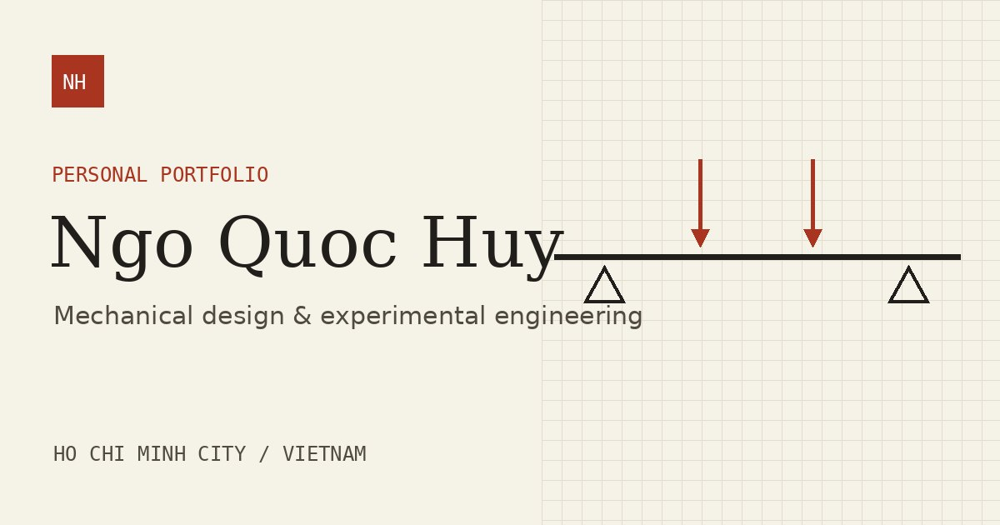

# Ngo Quoc Huy · Engineering Portfolio

A personal portfolio about things I’ve designed, built, and tested. It brings together a four-point bending experiment, a telescope mount, a tolerance-analysis prototype, and earlier work in electronics and fabrication.

[View the portfolio](https://quochuy2911.github.io/huyportfolio/)



## Work in the portfolio

- **Beam structural health monitoring** — Instrumentation and physics-informed stiffness estimation from sparse strain measurements.
- **Astronomical tracking mount** — CAD and prototyping for a four-axis mechanical design.
- **VSA3D Studio** — An engineering software prototype for Monte Carlo tolerance studies.
- **Build archive** — Earlier work in pneumatics, digital logic, electronics, and astronomical positioning.

## Develop locally

Use Node.js 20 or newer. The site has no package dependencies.

```sh
npm run dev
```

Open [the local preview](http://localhost:3000/huyportfolio/). After editing content or templates, run `npm run build` and refresh the page.

```sh
npm run build   # Regenerate the static pages and sitemap
npm run check   # Verify committed output matches the source
```

## Project structure

| Path | Purpose |
| --- | --- |
| `site/content.mjs` | Project data, timeline, and profile links |
| `site/templates.mjs` | Shared layout, homepage, and project-page templates |
| `site/build.mjs` | Static HTML and sitemap generator |
| `assets/` | Styles, analytics loader, optimized photos, and diagrams |
| `index.html`, `projects/` | Generated pages served by GitHub Pages |
| Legacy HTML files at the root | Redirects for links to the previous portfolio |

## Publish

GitHub Pages serves the root of `main`. Commit the source and regenerated output together. When a reviewed change is merged into `main`, GitHub Pages publishes it at the existing portfolio URL. The GA4 tag runs on that production URL.

The project photos and CAD images come from the original portfolio. The tolerance-study illustration is explanatory artwork.
